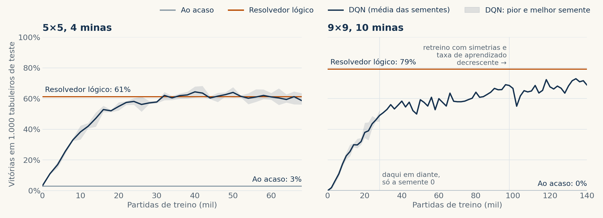
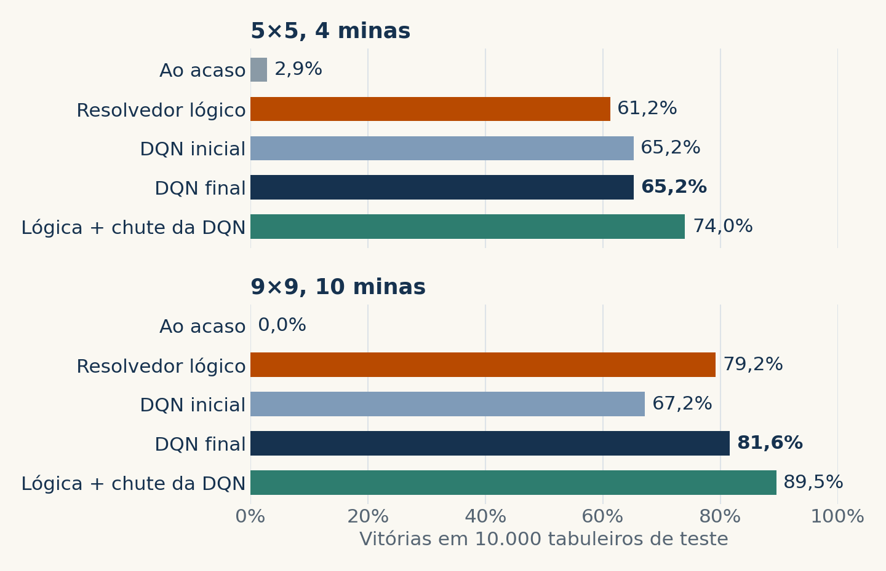

# Campo Minado com Aprendizado por Reforço

Agente de aprendizado por reforço que aprende a jogar Campo Minado: a cada jogada, escolhe uma casa
para abrir, tentando abrir todas as casas seguras sem acertar uma mina.

## Problema

Os números do tabuleiro permitem deduzir parte das jogadas, mas nem todas. Às vezes, há mais de uma
distribuição de minas possível, e é preciso arriscar. O agente não precisa saber onde está cada mina:
ele aprende quais casas têm mais chance de ser seguras.

## Modelagem (MDP)

| | |
|---|---|
| Ambiente | tabuleiro 5×5 com 4 minas e depois 9×9 com 10 minas; as minas são sorteadas a cada partida |
| Estado | tabuleiro visível: casas fechadas e números das casas abertas |
| Ações | escolher uma casa para abrir (25 no 5×5 e 81 no 9×9) |
| Recompensa | +10 ao vencer · +1 ao abrir uma casa segura · −1 ao clicar em uma casa já aberta · −10 ao abrir uma mina |

Os valores da recompensa são um ponto de partida e serão testados.

Apresentação da entrega 1 em [slides.pdf](entrega-01-modelagem/slides.pdf).

## Avaliação

A métrica principal é a taxa de vitórias, nos mesmos tabuleiros de teste. O agente é comparado com
clicar ao acaso (piso) e com um resolvedor lógico (referência alta).

## Resultados da DQN (entrega 2)

Vitórias em 10.000 tabuleiros de teste, que o agente não viu no treino:

| Política | 5×5, 4 minas | 9×9, 10 minas |
|---|---|---|
| Ao acaso | 2,9% | 0,0% |
| Resolvedor lógico (lógica + chute ao acaso) | 61,2% | 79,2% |
| DQN inicial | 65,2% | 67,2% |
| DQN retreinada (simetrias no treino, taxa de aprendizado decrescente) | 65,2%¹ | 71,6% |
| DQN retreinada + média nas 8 simetrias | 65,1% | 81,6% |
| **DQN final** (melhor versão na validação) | **65,2%** | **81,6%** |
| Lógica + chute da DQN | 74,0% | 89,5% |

¹ No 5×5, o retreino não superou a rede original na validação, então a rede comparada é a mesma.





- **Treino:** 3 sementes por tabuleiro. A primeira rodada foi interrompida: o 5×5 parou em cerca de
  70 mil partidas, já estável, e o 9×9 em cerca de 28 mil. As curvas dessa rodada foram reconstruídas
  dos registros em `resultados/logs/`. Depois, a semente 0 do 9×9 foi retomada (`--continuar-de`) até
  100 mil partidas.
- **Retreino** (`resultados/ajuste/`): a partir das melhores redes, com `--aumentar` (cada lote do
  replay é girado ou espelhado ao acaso) e `--lr-final` (taxa de aprendizado de 5·10⁻⁴ caindo até
  10⁻⁵ em forma de cosseno). No 9×9, foi de 98 mil para 140 mil partidas; no 5×5, de 32 mil para 72 mil.
- **Média nas simetrias:** o jogo não muda se o tabuleiro for girado ou espelhado. Na hora de jogar, a
  rede avalia as 8 versões do tabuleiro, e a média dos valores Q decide a jogada. No 9×9, isso rendeu 10
  pontos sem nenhum treino a mais.
- **Onde a DQN perde:** no 9×9, 69% das derrotas da DQN inicial aconteceram quando havia uma casa que a
  lógica garantia ser segura (no 5×5, 50%). Ou seja, ela ainda erra deduções.
- **Lógica + chute da DQN:** abre as casas que a lógica garante e só usa a DQN quando é preciso
  chutar. É o resolvedor com o chute ao acaso trocado pelo da DQN, e mostra que a DQN chuta muito
  melhor que o acaso.
- **Rede comparada:** em cada treino, escolhida entre as salvas pela taxa de vitórias em 2.000
  tabuleiros de validação, separados dos de teste. A versão final também é escolhida pela validação.
- **Vídeos:** a DQN inicial joga os mesmos 3 tabuleiros em 4 momentos do treino:
  [5×5](resultados/treino_5x5.mp4) e [9×9](resultados/treino_9x9.mp4).

### Detalhes da implementação

- **Jogo** ([campo_minado/ambiente.py](campo_minado/ambiente.py)): a primeira casa aberta nunca é
  mina. Se for, a mina vai para a primeira casa livre, então a mesma semente gera o mesmo tabuleiro
  para todas as políticas.
- **Resolvedor** ([campo_minado/politicas.py](campo_minado/politicas.py)): deduz casas seguras e minas
  a partir de cada número e de pares de números. Quando não há certeza, chuta ao acaso.
- **DQN** ([campo_minado/dqn.py](campo_minado/dqn.py)): rede só de convoluções, com 5 camadas de 32
  filtros. Ela recebe o tabuleiro em one-hot (fechada, 0 a 8) e dá um valor Q por casa.
- **Treino** ([treinar.py](treinar.py)): Double DQN com replay de 200 mil jogadas, rede-alvo copiada a
  cada 1.000 passos e γ = 0,1. Jogamos 32 partidas em paralelo, e ε cai de 1 até 0,01 nos primeiros
  30% do treino.
- **Recompensas:** as da modelagem. O agente só escolhe entre casas fechadas, então o −1 por clicar
  numa casa aberta nunca acontece no treino.

### Como rodar

```bash
pip install -r requirements.txt
python treinar.py --tabuleiro 5x5 --semente 0 --checkpoints   # também 9x9 e outras sementes
python treinar.py --tabuleiro 9x9 --episodios 140000 --aumentar --lr 5e-4 --lr-final 1e-5     --checkpoints --saida resultados/ajuste     --continuar-de resultados/9x9/checkpoints_semente0/ep0098001.pt   # retreino
python avaliar.py    # compara as políticas e gera resultados/resumo.json
python graficos.py   # gera os dois gráficos
python video.py --tabuleiro 9x9 --momentos 0 10000 30000 100000
```

## Equipe

- Cauê Fernando Faria Abreu
- Paulo Fernando Azevedo de Carvalho

Disciplina: Inteligência Artificial
